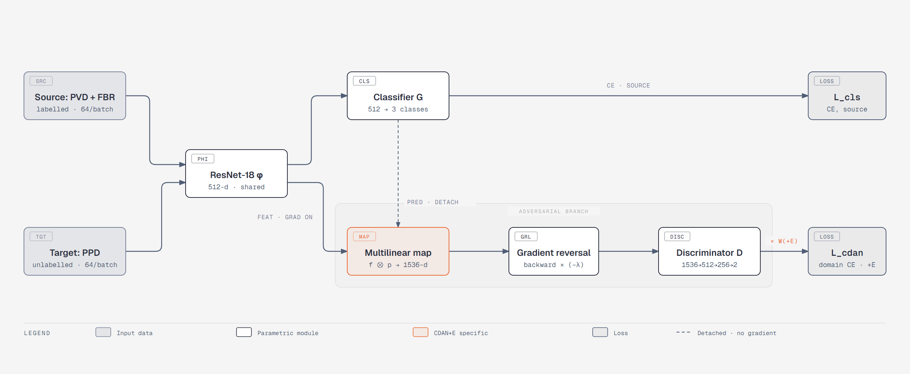
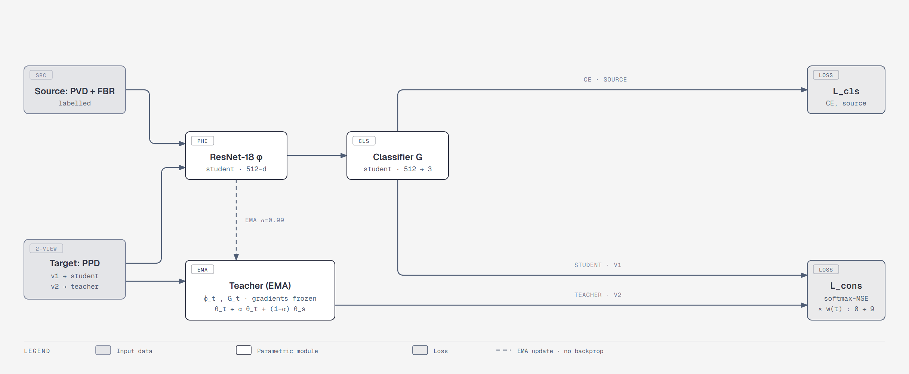
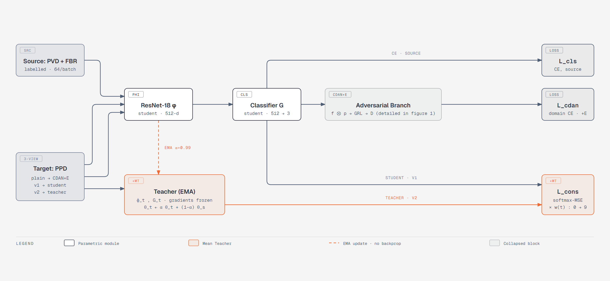

# Plant Disease Diagnosis Across Domains

Unsupervised domain adaptation (UDA) from lab leaf images to field images. A classifier trained on PlantVillage loses most of
its accuracy on field photographs, and no field labels exist to fix that directly. This repository studies three
components for that shift (field-adaptive background recomposition, CDAN+E, Mean Teacher) and, through **three experiments**
(A, B, C), compares them against each other and against published results.

| Arm                   | Objective                        |
| --------------------- | -------------------------------- |
| CDAN+E only           | `L_cls + L_cdan`                 |
| Mean Teacher only     | `L_cls + w(t) * L_cons`          |
| CDAN+E + Mean Teacher | `L_cls + L_cdan + w(t) * L_cons` |

## Experiments

| | Domain pair | Protocol | Backbone | Compared with | Notebook |
| --- | --- | --- | --- | --- | --- |
| **A** | PlantVillage apple → Plant Pathology 2020 | held-out test split (692 images) | ResNet-18 (ResNet-50 ablation) | Jeon et al. 2026 | [`A_apple_heldout.ipynb`](notebooks/A_apple_heldout.ipynb) |
| **B** | same | transductive: adapt on and evaluate all 1730 images | ResNet-50 | Wu et al. 2023 (MSUN) | [`B_apple_transductive.ipynb`](notebooks/B_apple_transductive.ipynb) |
| **C** | PlantVillage potato → PlantDoc potato | held-out test split (106 images) | ResNet-18 | Mahapatra et al. 2026 | [`C_potato_plantdoc.ipynb`](notebooks/C_potato_plantdoc.ipynb) |

[`Experiments_Summary.ipynb`](notebooks/Experiments_Summary.ipynb) rebuilds the two result tables below and the charts (no training).
The notebooks share one structure and one training setup (see "Reproducing").

## Data

| | A | B | C |
| --- | --- | --- | --- |
| Source (labelled, lab) | PlantVillage apple, 875 images (300 / 275 / 300) → 656 train / 219 val after FBR | same | PlantVillage potato early + late blight, 600 images (300 / class) → 450 train / 150 val |
| Target (unlabelled, field) | Plant Pathology 2020, 1038 images (60% of the 1730 single-label images) | all 1730 images | PlantDoc potato, 106 images (50% of 212 after MD5 deduplication) |
| Evaluation | 692 held-out images (40%), never used for training, model selection or FBR backgrounds | the same 1730 target images (labels used only to score) | 106 held-out images (50%, stratified) |
| Classes | healthy, rust, scab | same | early blight, late blight |

The source domain is capped at 300 images per class (apple rust has only 275). Plant Pathology rows labelled
`multiple_diseases` are dropped (91 of 1821) because PlantVillage has no matching class.

Source images are not used raw. Each is segmented with SAM and composited onto a patch of a real field image, a step referred
to here as FBR (field-adaptive background recomposition). Background patches come only from the unlabelled target images.

## Pipeline 1: CDAN+E only



Source and target images pass through one shared ResNet-18. The classification
head produces `L_cls` on labelled source images. The adversarial branch
conditions features on predictions through a multilinear map `f ⊗ p`, reverses
the gradient, and asks a discriminator to tell the domains apart. The `+E` term 
weights each sample by `1 + exp(-H(p))`, so confident predictions dominate the
domain loss.

## Pipeline 2: Mean Teacher only



The same student network, with the adversarial branch removed: no multilinear
map, no gradient reversal, no discriminator. Labelled source images give `L_cls`.
Each target image yields two independently augmented views; one feeds the
student and the other the teacher. The teacher is an exponential moving average
of the student, and the softmax MSE between their predictions is `L_cons`,
weighted by `w(t)`.

It shares the seed, the source batch stream, the optimiser, the `w(t)` schedule
and the teacher-based model selection with the other two arms. Because there is
no `L_cdan`, the student never sees the un-augmented target view.

This follows the Mean Teacher recipe of Tarvainen and Valpola, as applied to
plant disease images by Ilsever and Baz (2024), adapted to the domain-adaptation
setting. It differs from that paper in three ways worth stating: labelled and
unlabelled images come from different domains, `L_cons` is computed on target
images only, and the consistency weight ramps late (epoch 100 to 150, final
value 9) instead of over five epochs.

## Pipeline 3: CDAN+E plus Mean Teacher



Each target image now yields three views. The un-augmented view feeds the 
adversarial branch exactly as before; two independently augmented views feed
the student and a teacher. The teacher is an exponential moving average of 
the student, receives no gradient, and the disagreement between the two predictions
becomes `L_cons`, a softmax MSE weighted by `w(t)`.

- The EMA update walks parameters only and never touches BatchNorm buffers.
The teacher's buffers stay current because the teacher is kept in `.train()`
mode and its own forward passes update them. ResNet-18 has 20 BatchNorm
layers; leaving the teacher in `.eval()` makes it useless.
- The teacher is frozen at construction and its logits are additionally
computed under `no_grad`.
- Model selection reads the teacher, not the student. The teacher is the
product of the method; selecting on the student discards most of it.


## Results

Seed 42, 300 epochs per run, test accuracy in %. The numbers are the outputs saved in the notebooks from the Colab runs; they
have not been re-run since the notebooks were split (see "Reproducing"). A check mark means the component is on; "–" means not
applicable. **Runs not done yet are listed at the end of each block.**

### Table 1 — Ablation study

Each row differs from the one it is compared with by exactly one component, so the Δ column is that component's contribution.
Δ is only given where the two runs share backbone and SAM model.

| Exp | Method | FBR | CDAN+E | MT | Backbone | SAM | Test acc. | Δ |
| --- | --- | :-: | :-: | :-: | --- | --- | --: | --- |
| A | Source only | – | – | – | ResNet-18 | – | 60.40 † | |
| A | CDAN+E | ✓ | ✓ | – | ResNet-18 | ViT-B ‡ | 89.74 | |
| A | CDAN+E | ✓ | ✓ | – | ResNet-18 | ViT-H § | 94.08 | SAM ViT-B → ViT-H: **+4.34** |
| A | MT only | ✓ | – | ✓ | ResNet-18 | unconfirmed ‖ | 91.04 | |
| A | CDAN+E + MT | ✓ | ✓ | ✓ | ResNet-18 | ViT-B ‡ | **95.81** | + MT: **+6.07** |
| A | CDAN+E + MT | ✓ | ✓ | ✓ | ResNet-18 | ViT-H § | **96.82** | + MT: **+2.74**; SAM: +1.01 |
| A | CDAN+E + MT | ✓ | ✓ | ✓ | ResNet-50 | ViT-H § | **97.54** ¶ | backbone ResNet-18 → 50: +0.72 |
| B | CDAN+E | ✓ | ✓ | – | ResNet-50 | ViT-H ‡ | 92.95 | |
| B | CDAN+E + MT | ✓ | ✓ | ✓ | ResNet-50 | ViT-H ‡ | **98.50** | + MT: **+5.55** |
| C | CDAN+E + MT | ✓ | ✓ | ✓ | ResNet-18 | ViT-H | **66.98** | |

**Not run yet** (these would complete the ablation): FBR alone (`src_fbr`) and CDAN+E without FBR (`cdane_raw`) in A, B and C; MT only
with a confirmed SAM in A; every other arm in C. Without them, the contribution of FBR itself is not measured.

**Reading the table**

- **Mean Teacher helps on top of CDAN+E in all three cases it was measured**: +6.07 (A, ViT-B), +2.74 (A, ViT-H), +5.55 (B). In A the paired
  runs share the seed, the initialisation and the exact source-image stream (verified by the RNG probe), so the difference is attributable to
  `L_cons`; the effect is smaller when the SAM masks are better (ViT-H), i.e. the less adapted the starting point, the more Mean Teacher adds.
- **Better SAM masks help more than a bigger backbone.** ViT-H over ViT-B: +4.34 (CDAN+E), +1.01 (CDAN+E + MT); ResNet-50 over ResNet-18: +0.72.
- **The first two rows (A) bracket the whole effect**: 60.40 without adaptation → 89.74 with FBR + CDAN+E → 95.81 with Mean Teacher added.
- Every result is a single seed. Jeon et al. report ±4.22 for CDAN+E over five seeds, so differences of a few points are not yet evidence.

† Hard-coded constant (`acc_on_B`) from an earlier full run; its configuration was not recorded. ‡ SAM model as recorded in the earlier notes; B used the
`fbr_h_cache` FBR cache, which by its name holds ViT-H masks. § Recorded in the earlier README; not present in the saved notebook outputs. ‖ README
earlier listed 90.03 for "MT only, ViT-H", but 90.03 is the **student** accuracy of this same run (teacher 91.04). ¶ Saved output 97.54; the earlier README
said 97.64.

### Table 2 — Comparison across experiments and with the published results

| Exp | Domain pair, protocol | Backbone | Ours | Published | Comparable? |
| --- | --- | --- | --- | --- | --- |
| **A** | apple, held-out 692 | ResNet-18 | CDAN+E **89.74 / 94.08**; CDAN+E + MT **95.81 / 96.82** (ViT-B / ViT-H) | Jeon et al.: CDAN+E w/ FBR **91.1 ± 4.22**, baseline 47.1 ± 6.54, Real-to-Real 97.7 ± 0.77 | **Yes, closest.** Same protocol, backbone and hyper-parameters; compare CDAN+E only (Jeon has no MT). 1 seed vs 5; 875 vs 825 source images; FBR backgrounds taken from the target itself |
| **B** | apple, transductive 1730 | ResNet-50 | CDAN+E **92.95**; CDAN+E + MT **98.50** | MSUN (Wu et al.): **72.31**, DANN 50.04, baseline 39.27 | **Partly.** Same domain pair, protocol and backbone, but MSUN uses no FBR, so the gap mixes FBR with the method |
| **C** | potato → PlantDoc, held-out 106 | ResNet-18 | CDAN+E + MT **66.98** (early 64.29, late 70.00, mean 67.14) | Mahapatra et al., no adaptation: early 94.87, late 10.48 (mean 52.68 \*) | **Loosely.** Different backbone, input size and adaptation; only one arm run |

\* Computed here; the paper reports per-class accuracy only.

| | A | B | C |
| --- | --: | --: | --: |
| Best of ours | 97.54 (ResNet-50) / 96.82 (ResNet-18) | **98.50** | 66.98 |
| Same method, other protocol / pair | CDAN+E + MT ResNet-50 held-out: 97.54 | same, transductive: **98.50** (+0.96) | – |
| Difficulty of the target domain | easy (plain orchard photos) | easy | hard (internet photos, several leaves, clutter) |

**Across experiments**

- **A vs B (same data and source, different protocol):** the same configuration (ResNet-50, CDAN+E + MT) scores 97.54 held-out and 98.50 transductive,
  so scoring on the images used for adaptation inflates the number by about one point. B exceeds even Jeon et al.'s supervised Real-to-Real bound
  (97.7) because Mean Teacher trains on the very images it is scored on.
- **A/B vs C:** the pipeline reaches the 90s on Plant Pathology but 67% on PlantDoc potato. PlantDoc is a much harder domain; the two are not comparable numbers.
- **Class balance:** in B every class is above 91%, whereas every method in MSUN's Table 6 scores scab highest and leaves rust or healthy low; in C the
  published model collapses to one class (94.87 / 10.48) while this pipeline is balanced (64.29 / 70.00).
- **Not yet supported:** attributing the gap to MSUN or Mahapatra's models to CDAN+E or Mean Teacher rather than FBR, which needs the missing `cdane_raw` and `src_raw` rows.


## Alignment with published baselines

Three papers are compared against. Jeon et al. describes the same experiment as A; Wu et al. (MSUN) runs the same domain pair under a different,
transductive protocol (B); Mahapatra et al. supplies a source-only number for the potato pair (C). Ilsever and Baz (2024) is cited only as the source
of the Mean Teacher recipe used in Pipeline 2; it is a single-domain semi-supervised study and none of its numbers are compared.

### A — Jeon et al., 2026 (`papers/10_1-s2.0-S1574954125005886-main.pdf`) — comparable

This is the source of FBR and of the 91.1 +/- 4.22% CDAN+E figure quoted
above. Every training-affecting choice in this repository was checked against
the paper's Section 3.2-3.3 and Table 1-2:


| Choice                             | Paper                                                           | This repository                                 |
| ---------------------------------- | --------------------------------------------------------------- | ----------------------------------------------- |
| Backbone                           | ResNet-18, ImageNet-pretrained                                  | same                                            |
| Source domain                      | PVD, apple, 825 images, 3 classes                               | same dataset, same classes, same public source  |
| Source split                       | 75 / 25 train / val, applied after FBR to the entire source set | same                                            |
| Target/test ratio                  | PPD, 900 adaptation / 600 test — a 60 / 40 ratio                | same ratio (1038 / 692 of 1730 filtered images) |
| Batch size                         | 64                                                              | same                                            |
| Optimizer                          | AdamW, lr 1e-3                                                  | same                                            |
| Schedule                           | CosineAnnealingLR                                               | same                                            |
| Adversarial run length / selection | 300 epochs, select on lowest val loss from epoch 250            | same                                            |
| CDAN discriminator                 | 2 hidden layers, 512 then 256 units                             | same                                            |
| Entropy weight (`+E`)              | `1 + exp(-H(p))`                                                | same                                            |


Two differences that matter for interpretation:

- **Seeds.** The paper reports mean +/- std over 5 seeds; this repository
reports a single seed (42). A standard deviation of 4.22 points on the
paper's own runs means a one-seed delta of a few points is not evidence of
being better or worse than the paper, only of being consistent or
inconsistent with its reported range. Running `--arm cdane` under
additional seeds is what would close that gap.
- **FBR background pool.** The paper draws its 900 target and 600 test images
from a much larger PPD pool (~4900 images) and explicitly reserves the
*remaining* images — a set disjoint from both target and test — as the
source of background patches for FBR ("Section 3.1: *the remaining
real-field images from these datasets were used for the proposed
background augmentation method*"). This repository has no such third pool:
`load_ppd_samples` keeps every single-label PPD image (1730 after
filtering), and `split_ppd` divides all of it 60/40 into target and test.
The FBR cache then draws its background patches from the target split
itself (see the comment "Background images from the TARGET split only" in
the FBR pre-compute cell) — the same 1038 images that are later used as
the unlabeled domain-alignment/consistency set. The ratio matches the
paper; the independence of the background pool from the target pool does
not. Each target image is therefore used twice (as a background donor and
as an adaptation sample), which the paper's design avoids. This has not
been shown to bias the reported numbers, but it is a real deviation from
the published protocol, not just a smaller dataset.


### B — Wu et al., 2023 (MSUN), comparable under its own protocol

Wu, Fan, Luo, Choudhury, Tjahjadi and Hu. *From Laboratory to Field: Unsupervised Domain Adaptation for Plant Disease Recognition in the Wild.*
Plant Phenomics 5:0038 (2023). Its PVD → Plant-Pathology experiment uses the same two public datasets and the same three apple classes as this
repository, and Table 6 reports eight methods on it, including DANN. The method itself (MSUN) is not re-implemented here and the authors publish no
code; only the evaluation protocol is matched, then this repository's own pipeline is run under it.

| Choice          | MSUN (PVD → PP)                                   | Notebook B                                         |
| --------------- | ------------------------------------------------- | -------------------------------------------------- |
| Target domain   | PPD, all images, unlabelled                       | all 1730 single-label PPD images, unlabelled       |
| Evaluation set  | the same target images (transductive)             | same                                               |
| Backbone        | ResNet-50, ImageNet-pretrained                    | same                                               |
| Source domain   | PVD apple, raw images                             | PVD apple through FBR (875 images, 656 train)      |
| Optimisation    | SGD, momentum 0.9, 200 epochs                     | AdamW, cosine, 300 epochs (this pipeline's own)    |

| Method                            | Scab  | Rust  | Healthy | Accuracy |
| --------------------------------- | ----- | ----- | ------- | -------- |
| Baseline (w/o DA) — MSUN Table 6  | 79.54 | 24.10 | 11.02   | 39.27    |
| DANN — MSUN Table 6               | 85.12 | 30.26 | 28.71   | 50.04    |
| MRAN — MSUN Table 6               | 81.28 | 52.57 | 70.87   | 67.45    |
| MSUN — MSUN Table 6               | 87.32 | 57.71 | 73.86   | 72.31    |
| CDAN+E (ours, FBR)                | 91.39 | 95.66 | 91.47   | 92.95    |
| CDAN+E + Mean Teacher (ours, FBR) | 97.97 | 99.84 | 97.48   | 98.50    |

(DAN, D-Coral, DAAN and DSAN fall between DANN and MRAN; the notebook prints all eight.)

**The target set is very likely the same 1730 images.** MSUN's Table 2 lists PPD as 1604 / 370 / 1411 (scab / rust / healthy). Those counts are identical
to the corn table of the same paper, and Table 6 mislabels its scab column as "Gray spot", so Table 2 cannot be taken at face value. Weighting Table 6's
per-class accuracies by PP2020's single-label class counts (592 / 622 / 516) reproduces the published "Average" column within 0.5 points for six of the
eight methods (e.g. MSUN 72.66 vs 72.31, baseline 39.17 vs 39.27). Weighting by Table 2's counts misses by up to 8.6 points. "Average" is therefore read as
overall accuracy on the 1730-image set. This is an inference from the numbers; the paper does not state it.

Four things to state alongside the gap:

- **FBR is part of the pipeline; the eight methods in Table 6 use raw PVD images.** Jeon et al. report DANN at 72.4% with FBR on the same domain pair
(different protocol), against 50.04% without FBR here. A large part of the gap to Table 6 is likely FBR, not CDAN+E or Mean Teacher. A CDAN+E run under
this protocol **without** FBR (`cdane_raw`) is the row that would separate the two; it has not been run.
- **FBR backgrounds come from evaluated images.** The background pool is the 1038-image adaptation split, which under this protocol is a subset of the
evaluation set. Unlabelled use of target images is legitimate in transductive UDA, but none of the Table 6 methods injects target pixels into source images
this way. PP2020's unlabelled Kaggle test images (`Test_*.jpg`) would give a pool disjoint from evaluation; not yet run.
- **Transductive evaluation inflates slightly.** The same configuration (ResNet-50, CDAN+E + Mean Teacher) gives 97.54% on the held-out 692-image split
(experiment A) and 98.50% here.
- **One seed.** Sampling error on 1730 images is about ±0.6 points at 98.5%, but seed-to-seed variance is unmeasured (Jeon et al. report ±4.22 for CDAN+E).

What the comparison supports: under MSUN's evaluation protocol and backbone, the FBR + CDAN+E (+ Mean Teacher) pipeline is far more accurate than every method in
MSUN's Table 6 and, unlike all of them, balanced across the three classes. What it does not yet support: attributing that gap to CDAN+E or Mean Teacher rather than FBR.
Within this protocol, adding Mean Teacher to CDAN+E is a paired comparison (same seed, same data stream) and moves accuracy from 92.95% to 98.50%.

### C — Mahapatra et al., 2026 (`papers/5_Advancing plant disease classification using an attention-based CNN for intra-dataset and cross-dataset training.pdf`) — loosely comparable

Mahapatra, Panda, Dash and Sahu. *Advancing plant disease classification using an attention-based CNN for intra-dataset and cross-dataset training.*
Scientific Reports 16 (2026) 10925. Its cross-dataset experiment trains on PlantVillage potato and tests on PlantDoc potato (early and late blight, the two
classes both datasets share), with no adaptation of any kind.

| Choice        | Mahapatra et al.                                   | Notebook C                                            |
| ------------- | -------------------------------------------------- | ----------------------------------------------------- |
| Domain pair   | PlantVillage potato → PlantDoc potato, 2 classes   | same                                                  |
| PlantDoc test | 50% of PlantDoc (35 / 15 / 50 split)               | 50%, stratified, after MD5 deduplication (106 images) |
| PlantDoc rest | labelled training data for its intra-dataset runs  | unlabelled adaptation target                          |
| Model         | attention-based CNN, 150 × 150 input               | ResNet-18, 224 × 224, FBR (SAM ViT-H) + CDAN+E + Mean Teacher |
| Adaptation    | none                                               | yes                                                   |

| Method                                    | Early blight | Late blight | Mean of 2 |
| ----------------------------------------- | ------------ | ----------- | --------- |
| Attention CNN, source only (Table 21)     | 94.87        | 10.48       | 52.68*    |
| CDAN+E + Mean Teacher (ours, seed 42)     | 64.29        | 70.00       | 67.14     |

\* Computed here; the paper reports per-class accuracy only, not an overall or mean figure.

How to read it:

- **The published model predicts almost every field image as early blight.** 94.87 / 10.48 is close to a constant classifier (100 / 0, mean 50). Its high
early-blight number is the by-product of that collapse, so the drop to 64.29 here is not a regression in early-blight recognition. The per-class mean is the
fair single number for a two-class problem: 52.68 vs 67.14.
- **The gap cannot yet be attributed to the method.** Backbone, input resolution and adaptation all differ at once. The notebook's `src_raw` arm (ResNet-18, raw
PlantVillage, no adaptation, same split) is the row that separates "better backbone" from "adaptation works"; it has not been run.
- **Small test set.** 106 images: one image is about 0.9 points, and the 95% interval around 67% is roughly ±9 points (±13 per class). One seed.
- **Ambiguity in the paper.** It says the model was "tested on the images of PlantDoc" without stating whether that means all 222 images or only the 50% test split;
this repository uses the 50% split so no evaluated image is ever trained on.
- **PlantDoc is much harder than Plant-Pathology.** Internet images, several leaves per image, cluttered backgrounds; models trained on PlantVillage alone score roughly
30–60% on PlantDoc in the papers cited here (e.g. 30.78% for MSUN's 27-class baseline). Accuracy in the 60s here is not directly comparable to the 90s on the apple pair.

## Repository layout

```
plantuda/              Package implementing experiment A's two arms (cdane, mt) with ResNet-18
  config.py            Dataclasses describing a run: paths, data, training, Mean Teacher
  seeding.py           Seeding, the shared DataLoader generator, per-epoch re-seeding
  data/
    transforms.py      Stochastic train transform, deterministic evaluation transform
    datasets.py        PlantDiseaseDataset, TargetThreeViewDataset
    splits.py          Domain loading, stratified and seeded splits, FBR cache listing
    loaders.py         DataLoader construction and the Loaders bundle
  fbr/
    segment.py         SAM loading, leaf segmentation, mask refinement
    compose.py         Background patch sampling and alpha compositing
    cache.py           One composite per source image, written once and reused
  models/
    networks.py        ResNet-18 feature extractor, classifier, conditional discriminator
    grl.py             Gradient reversal and its lambda schedule
    cdan.py            Multilinear map and the entropy weight
    mean_teacher.py    Ramp, consistency loss, teacher construction, EMA update
  engine/
    train.py           The loop shared by both arms
    checkpoint.py      Resumable checkpoints, including teacher BatchNorm buffers
    evaluate.py        Test-set accuracy
scripts/
  prepare_data.py      Download both datasets
  build_fbr_cache.py   Pre-compute the FBR source images
  rng_probe.py         Verify that both arms see the same data stream
  train.py             Train one arm
  compare.py           Print the comparison table from stored results
  export_figures.py    Regenerate the figures from their HTML source
figures/
  pipeline-cdane-vs-mt.html   Source of truth for all three diagrams
  pipeline-cdane.[png|svg]    Generated
  pipeline-mt-only.[png|svg]  Generated
  pipeline-cdane-mt.[png|svg] Generated
notebooks/             Colab notebooks that produced the results above (outputs saved inside)
  A_apple_heldout.ipynb        Experiment A: all three arms, the SAM / backbone ablation, comparison with Jeon et al.
  B_apple_transductive.ipynb   Experiment B: transductive protocol, comparison with MSUN
  C_potato_plantdoc.ipynb      Experiment C: potato, comparison with Mahapatra et al.
  Experiments_Summary.ipynb    The two result tables and charts, no training
tests/
```

## Reproducing

### The three experiments (Colab, GPU)

Open the notebook in Colab, set `SAVE_DIR` in section 2 to a folder on your Drive, and run the cells top to bottom. All three notebooks share the same structure
(§2 configuration → §3 data → §4 SAM + FBR → loaders → models → training → results) and the same training set-up: AdamW lr 1e-3, weight decay 0.01, cosine schedule,
300 epochs, model selected by validation loss on the source from epoch 250 (no target labels), seed 42; Mean Teacher EMA 0.99 with `w(t)` zero until epoch 100 and then
ramped to `C²` over 50 epochs. In section 2, `SAM_MODEL_TYPE` (`'vit_b'` | `'vit_h'`) is the one switch that picks the SAM model; it also selects the FBR cache and the
`runs_<sam>/` (A, B) or `results_<sam>/` (C) folder, so two SAM models never overwrite or skip each other's results.

| To reproduce | Notebook | Settings | Cells to run |
| --- | --- | --- | --- |
| A: CDAN+E 89.74, CDAN+E + MT 95.81, MT only 91.04 | `A_apple_heldout.ipynb` | `SAM_MODEL_TYPE = 'vit_b'` (cache `fbr_cache`) | §3, §4, loaders, §5.1–5.2, then 5.3, 5.4 (helpers + `run_mt_only`), 5.5 (`train_cdane`, `run_mt`) |
| A: CDAN+E 94.08, CDAN+E + MT 96.82 | same | `SAM_MODEL_TYPE = 'vit_h'` (cache `fbr_h_cache`) | same |
| A: CDAN+E + MT, ResNet-50 (97.54) | same | `vit_h` | 5.7 (`run_mt_resnet50`) after the cells above |
| B: CDAN+E 92.95, CDAN+E + MT 98.50 | `B_apple_transductive.ipynb` | `vit_h`, ResNet-50 (set in `MSUN_RUNS`) | all definition cells, then §5.8 |
| C: CDAN+E + MT 66.98 | `C_potato_plantdoc.ipynb` | `vit_h`, `RUN_ARMS = ['cdane_mt']` | through §7, then §8 |

Notes. (1) The FBR caches already on Drive are reused, so SAM is not re-run; if a cache is missing it is rebuilt with the same fixed seed. (2) Each run writes a JSON
result and checkpoints every ten epochs and resumes after a Colab disconnect; delete the JSON to force a fresh run. (3) The Kaggle token for Plant Pathology is read from
Colab Secrets (`KAGGLE_API_TOKEN`) or the environment, never from the notebook. (4) Cross-hardware or cross-version runs can differ slightly because some GPU operations are not
fully deterministic. (5) Experiment A's ablation was run across different sessions (the SAM model is not recorded in the saved outputs of 5.3–5.7), which is why Table 1 flags
which SAM is confirmed.

### The `plantuda` package (CPU / GPU, command line)

`plantuda/` is a separate, tested implementation of experiment A's two paired arms (`cdane`, `mt`) with ResNet-18; it does not implement the Mean-Teacher-only arm, and its
numbers are not the ones in Table 1.

```bash
pip install -r requirements.txt
export UDA_SAVE_DIR=/path/to/workspace     # datasets, caches, checkpoints, results

export KAGGLE_USERNAME=... KAGGLE_KEY=...  # required for PlantPathology
python scripts/prepare_data.py
python scripts/build_fbr_cache.py          # needs a GPU for SAM; resumable

python scripts/rng_probe.py                # verify the pairing before training
python scripts/train.py --arm cdane
python scripts/train.py --arm mt
python scripts/compare.py
```

Each arm writes `<UDA_SAVE_DIR>/results/<arm>_s<seed>.json` and skips itself if that file exists; pass `--force` to re-run. Checkpoints are written every ten epochs and
resumed automatically. A full run is 300 epochs per arm. For a fast end-to-end check, shorten every schedule so the consistency term is actually exercised:

```bash
python scripts/train.py --arm mt --epochs 4 --min-select 3 \
    --cons-start 1 --cons-ramp-len 2 --log-every 1 --force
```

## Figures

`figures/pipeline-cdane-vs-mt.html` is the single source for all three diagrams. It
is a self-contained HTML file: open it in a browser to view, edit the inline
SVG to change a label or a box, then regenerate the exported files.

```bash
python scripts/export_figures.py           # writes .svg and 2x .png for each diagram
python scripts/export_figures.py --scale 3 # print resolution
```

The README references the generated PNG files by path, so a regenerated figure
appears here with no edit to this document. PNG is used for display because it
carries the intended typography everywhere; the SVG files are for LaTeX and
vector editing. PNG export drives Playwright when installed and otherwise a
local Chrome or Chromium in headless mode.

## Notes

Datasets, checkpoints and caches live under `UDA_SAVE_DIR` / `SAVE_DIR` and are never committed. Credentials for the PlantPathology download are read from the environment or
Colab Secrets; if a token was ever pasted into a notebook cell, rotate it and treat the old one as public.

## References

- Long et al. Conditional Adversarial Domain Adaptation. NeurIPS 2018.
- Ganin and Lempitsky. Unsupervised Domain Adaptation by Backpropagation. ICML 2015.
- Tarvainen and Valpola. Mean teachers are better role models. NIPS 2017.
- Laine and Aila. Temporal Ensembling for Semi-Supervised Learning. ICLR 2017.
- Kirillov et al. Segment Anything. ICCV 2023.
- Jeon et al. Bridging the Lab-to-Field gap in plant disease diagnosis through unsupervised domain adaptation enhanced by background recomposition.
Ecological Informatics 93 (2026) 103579. Source of FBR and of the CDAN+E baseline experiment A is compared with.
- Wu et al. From Laboratory to Field: Unsupervised Domain Adaptation for Plant Disease Recognition in the Wild. Plant Phenomics 5 (2023) 0038. Source of the MSUN / DANN /
baseline numbers experiment B is compared with.
- Mahapatra, Panda, Dash and Sahu. Advancing plant disease classification using an attention-based CNN for intra-dataset and cross-dataset training. Scientific Reports 16 (2026)
10925. Source of the PlantVillage → PlantDoc potato source-only figures experiment C is compared with.
- Ilsever and Baz. Consistency regularization based semi-supervised plant disease recognition. Smart Agricultural Technology 9 (2024) 100613. Source of the Mean Teacher recipe
adapted in Pipeline 2 (single-domain study; its numbers are not used).
